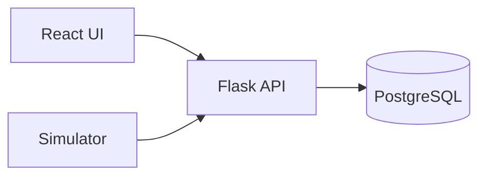
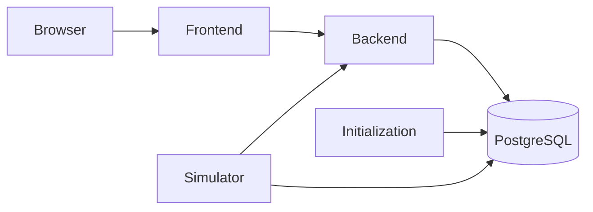

# Parkify

Parkify is a real-time parking platform for one garage. Operators watch occupancy, sessions, and reservations. Customers do not use this application. The simulator submits reservation requests, and an admin or employee approves them before a spot is held.

Occupancy is derived from open sessions, covering reservations, and maintenance. It is not stored on a spot.

## Architecture

HTTP controllers call services. Services apply the business rules and transactions. Repositories own SQLAlchemy access. The React app and the simulator call `/api` and do not hold database credentials.

Sign-in creates a server-side session and a JWT. The JWT is stored only in the HttpOnly `parkify_session` cookie. Changes also require the `parkify_csrf` cookie and an `X-CSRF-Token` header. The Docker demo uses `parkify_demo_session` and `parkify_demo_csrf` instead. Roles come from the user row, not from the request.



The standalone Docker demo adds a local database and an initializer. It does not use Neon.



```text
frontend/       React app
controllers/    HTTP routes and auth checks
services/       Business rules and permissions
repositories/   Database access
models/         ORM
migrations/     Alembic
config/         Settings
scripts/        Users, isolated stack, and simulator
tests/          pytest
docker/         Images
```

## Stack

React, TypeScript, Vite, Three.js, and Nginx. Python, Flask, SQLAlchemy, Alembic, Argon2id, and PyJWT. PostgreSQL, either through Neon or the local Docker demo. Docker Compose.

## Quick start

Copy `.env.example` to `.env`. Do not commit `.env`.

- `DATABASE_URL` — pooled URL for the running API
- `MIGRATION_DATABASE_URL` — direct URL for Alembic
- `TEST_DATABASE_URL` — separate database for pytest and the simulator. It must not be the primary or migration database.
- `JWT_SECRET` — required in production. At least 32 random characters.
- `FACILITY_ID` and `VITE_FACILITY_ID` — optional. The seeded facility is `facility-skyline`.

```bash
python3 -m venv .venv
source .venv/bin/activate
pip install -r requirements-dev.txt
alembic upgrade head
python -m repositories.seed
```

`alembic upgrade head` uses `MIGRATION_DATABASE_URL`. Pytest migrates `TEST_DATABASE_URL` on its own. There is no public registration.

Isolated stack, used for development and the simulator:

```bash
make start
```

UI: http://127.0.0.1:5174/ · API: http://127.0.0.1:5002

`npm run dev` in `frontend/` proxies `/api` to port 5001. Use that only against an API you intend to change.

## Standalone Docker demo

Prerequisite: Docker Desktop or Docker Engine with Compose. No host Python, Node.js, Neon account, or `.env` file is required.

```bash
git clone https://github.com/snirtal/Parkify.git
cd Parkify
docker compose -f compose.demo.yaml up --build -d
```

UI: http://127.0.0.1:5175 · API: http://127.0.0.1:5003

PostgreSQL starts first. Initialization runs Alembic and, on an empty volume, seeds the facility and three accounts. The backend starts after initialization succeeds. The frontend and simulator start after the backend is healthy.

| Account | Password |
|---|---|
| admin@parkify.demo | Demo-Admin-Pass1 |
| employee@parkify.demo | Demo-Employee-Pass1 |

The simulator signs in as `simulator@parkify.demo`. These passwords and the plain-HTTP cookies exist only for a local demonstration. Do not publish this stack or reuse these values in production.

Demo sessions use `parkify_demo_session` and `parkify_demo_csrf`, so they do not replace a session from the isolated app on port 5174. The session JWT stays in the HttpOnly cookie.

```bash
docker compose -f compose.demo.yaml logs -f
docker compose -f compose.demo.yaml logs -f simulator
docker compose -f compose.demo.yaml stop simulator
docker compose -f compose.demo.yaml start simulator
docker compose -f compose.demo.yaml down
```

`down` stops the containers and keeps the named volume `parkify-demo-data`. The next `up` reuses that data. Initialization sees the existing facility and accounts and does not overwrite them. The volume is independent of Neon.

This deletes every row in the demo volume, including reservations, sessions, and the demo accounts:

```bash
docker compose -f compose.demo.yaml down -v
```

## User roles

| Role | Can do | Cannot do |
|---|---|---|
| Admin | Everything, including settings, prices, and direct reservations | — |
| Employee | Read occupancy, review reservation requests, approve, and reject | Settings, prices, sessions, and the gate |
| Simulator | Read occupancy and reservations, create requests, enter, and exit | Approve, reject, settings, and prices |

Unknown roles and unknown permissions are denied. Missing credentials return 401. A signed-in caller without permission returns 403. Responses for callers without `pricing.read` omit rates, quotes, and `paid_until`.

## Initial user creation

The password prompt is hidden. The command writes to `DATABASE_URL` and does not print the password or its hash.

```bash
.venv/bin/python scripts/create_user.py \
  --email admin@parkify.example \
  --full-name "Ada Admin" \
  --role admin
```

Repeat with `--role employee` or `--role simulator`. Create the simulator user on the isolated database only:

```bash
.venv/bin/python - <<'PY'
import os, runpy, sys
from scripts.run_isolated_api import isolated_database_url
os.environ["DATABASE_URL"] = isolated_database_url()
sys.argv = [
    "create_user.py",
    "--email", "simulator@parkify.example",
    "--full-name", "Parkify Simulator",
    "--role", "simulator",
]
runpy.run_path("scripts/create_user.py", run_name="__main__")
PY
```

That command refuses to run when the test database is the primary or migration database.

## Simulator

The simulator signs in with `SIMULATOR_EMAIL` and `SIMULATOR_PASSWORD`. It exits when either value is missing. Its cookies stay in its own process. A 401 signs it in once and retries the request.

Every five seconds it moves the facility clock forward five minutes. Every `SIMULATOR_REQUEST_EVERY_TICKS` ticks (default 4) it submits one request. Pending requests do not hold a spot. After approval, it enters the assigned spot during the reservation window and exits when the window ends. Other LX traffic continues.

```bash
make start      # isolated API, frontend, and simulator
make stop       # simulator only; the app stays up
make shutdown   # isolated API, frontend, and simulator
make logs       # follow .live/api.log, web.log, and simulator.log
make reset      # confirm, then remove simulator rows on the test database
```

`make stop` and `make shutdown` do not signal the Docker processes on ports 5001 and 5173.

## Authenticated API

Errors use `{"error": {"code": "...", "message": "..."}}`. Health and login are public. Other changes need the session cookie and `X-CSRF-Token`. These examples use the isolated API.

```bash
curl -s -c /tmp/parkify.cookies -b /tmp/parkify.cookies \
  -H 'Content-Type: application/json' \
  -X POST http://127.0.0.1:5002/api/auth/login \
  -d '{"email":"admin@parkify.example","password":"your-password"}'

csrf=$(awk '$6 == "parkify_csrf" { print $7 }' /tmp/parkify.cookies)

curl -s -b /tmp/parkify.cookies \
  http://127.0.0.1:5002/api/facilities/facility-skyline/reservation-requests

curl -s -b /tmp/parkify.cookies -c /tmp/parkify.cookies \
  -H "X-CSRF-Token: $csrf" -H 'Content-Type: application/json' \
  -X POST http://127.0.0.1:5002/api/facilities/facility-skyline/reservation-requests/REQUEST_ID/approval \
  -d '{}'
```

Logout is `POST /api/auth/logout` with the same cookie and CSRF header. It returns 204 and deletes the server session.

## Docker

`compose.yaml` is the existing Neon workflow. It is separate from the standalone demo above. Compose publishes the API on http://127.0.0.1:5001 and the UI on http://127.0.0.1:5173. Nginx proxies `/api` to the backend. Both services have health checks. `/api/health` does not require a session.

The API container runs with `PARKIFY_ENV=production`. Set `JWT_SECRET` in `.env` before `docker compose up --build -d`. Production session cookies are `Secure` and `SameSite=Strict`. Browsers store `Secure` cookies only on HTTPS, so browser login needs a TLS terminator in front of the published HTTP ports. Do not turn `Secure` off to make plain HTTP work. curl can still send the cookies itself.

Compose does not run Alembic and does not contain database credentials in the image. Apply migrations with `alembic upgrade head` before starting the stack. `docker compose down` stops containers. Neon data stays.

```bash
docker compose logs -f backend
docker compose --profile test run --rm --no-deps -T --build backend-test
```

## Tests and logging

Database tests roll back. They skip when `TEST_DATABASE_URL` is missing, a placeholder, or the same database as `DATABASE_URL` or `MIGRATION_DATABASE_URL`.

```bash
pytest -q
cd frontend && npm test && npm run build
```

Each request is logged with a request id. Logs omit passwords, tokens, and connection strings. Isolated logs are in `.live/`. Docker logs use the json-file driver.

## Future improvements

Not built yet: a customer application, HTTPS in front of Docker, AWS, Gunicorn, CI/CD, Redis, Swagger, monitoring, and load testing.
