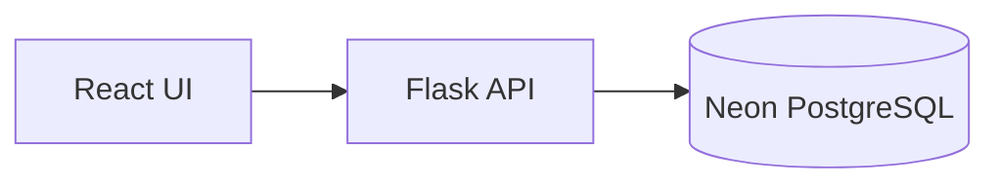

# Parkify

Parkify is a real-time parking platform for garage occupancy, sessions, and reservations. A React app and a Flask API share one facility. Occupancy is derived from open sessions, covering reservations, and maintenance.

## Features

- Dashboard, 3D parking map, active sessions, reservations, analytics, and settings
- Vehicle entry, exit, and price quotes
- Live simulator against an isolated database

## Stack

React, TypeScript, Vite, Three.js, and Nginx. Python, Flask, SQLAlchemy, and Alembic. Neon PostgreSQL. Docker Compose.

## Architecture



Requests pass through controllers, services, and repositories. The UI calls `/api` and does not hold database credentials.

## Structure

```text
frontend/       React app
controllers/    HTTP routes
services/       Business rules
repositories/   Database access
models/         ORM
migrations/     Alembic
config/         Settings
scripts/        Isolated stack and simulator
tests/          pytest
docker/         Images
```

## Quickstart

Copy `.env.example` to `.env`. Do not commit `.env`.

- `DATABASE_URL` — pooled Neon URL for the API
- `MIGRATION_DATABASE_URL` — direct Neon URL for Alembic
- `TEST_DATABASE_URL` — separate Neon branch for tests and the simulator. Never reuse `DATABASE_URL`.
- `FACILITY_ID`, `VITE_FACILITY_ID` — optional, default `facility-skyline`. `LOG_LEVEL` — optional.

```bash
python3 -m venv .venv
source .venv/bin/activate
pip install -r requirements-dev.txt
alembic upgrade head
python -m repositories.seed
docker compose up --build -d
```

API: http://127.0.0.1:5001 · Frontend: http://127.0.0.1:5173. `docker compose down` stops containers only. Neon data stays. `npm run dev` in `frontend/` proxies `/api` to port 5001.

## Simulator

Uses `TEST_DATABASE_URL` only. Ports 5001 and 5173 stay untouched. UI: http://127.0.0.1:5174/

- `make start` — start or resume the isolated API (5002), frontend (5174), and simulator
- `make stop` — stop the simulator; the app stays up
- `make shutdown` — stop the isolated API, frontend, and simulator
- `make reset` — confirm, then delete simulator rows on the test branch. Seed data stays.

## Logs

```bash
docker compose logs -f backend   # API on port 5001
tail -f .live/api.log            # isolated API
tail -f .live/simulator.log      # simulator
```

## API

GET uses port 5001 and does not change data. POST and PATCH use port 5002 after `make start`. Do not send writes to port 5001. Pick an available spot. Rates are decimal strings.

```bash
curl -s "http://127.0.0.1:5001/api/facilities/facility-skyline/spots?status=available"
curl -s -X POST http://127.0.0.1:5002/api/facilities/facility-skyline/entries -H 'Content-Type: application/json' -d '{"plate_number":"DOC-100","spot_code":"P-101"}'
curl -s -X PATCH http://127.0.0.1:5002/api/facilities/facility-skyline/settings -H 'Content-Type: application/json' -d '{"hourly_rate":"4.20","grace_period_minutes":15}'
```

## Testing

From the repository root, with the virtualenv active. Database tests roll back and skip when `TEST_DATABASE_URL` is missing or matches the primary database.

```bash
pytest -v
docker compose --profile test run --rm --no-deps -T --build backend-test
cd frontend && npm test && npm run build
```

## Future improvements

Not built yet: authentication, AWS, Gunicorn, CI/CD, Redis, Swagger, monitoring, and load testing.
